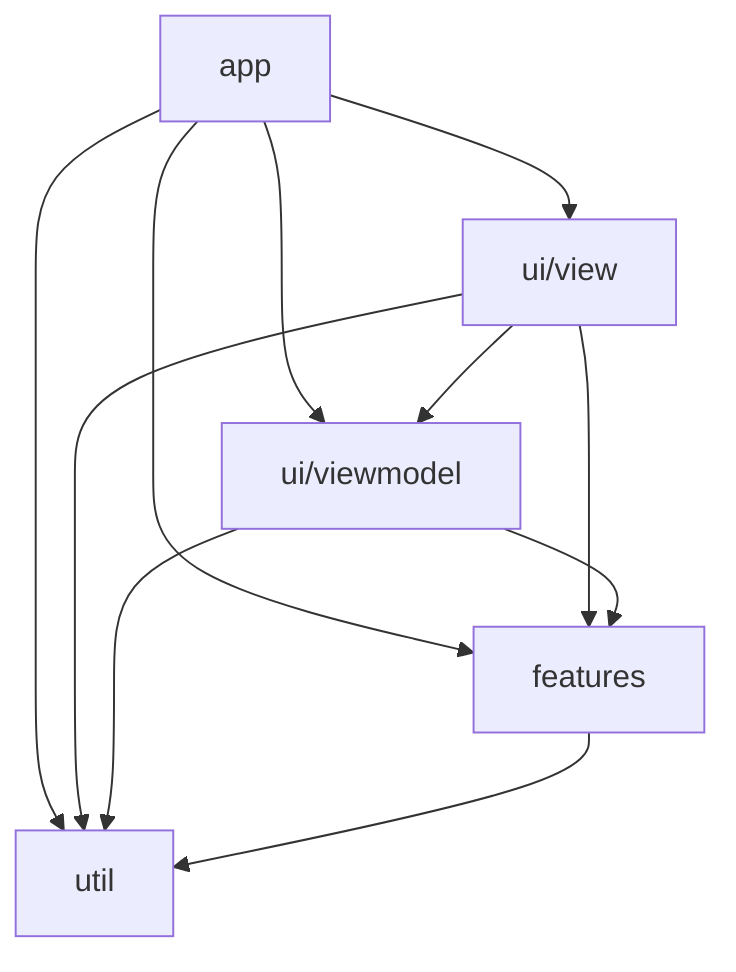

# 架构与依赖边界

`internal` 按功能、界面、应用协调和通用工具四层组织。四层是代码的归属，不要求把独立资源合成一个 Go 包，也不为每个功能机械增加 model/service/store 层级。

配套阅读：[代码规范](coding-standards.md)、[数据与生命周期](data-lifecycle.md)、[新增功能](adding-features.md)、[功能索引](features/README.md)。

## 1. 目录结构

```text
internal/
├── features/              功能与业务能力
│   ├── player/session/    播放及会话持久化
│   ├── download/tagging/  下载导出及标签写入
│   ├── speech/transcript/ 转写及字幕持久化
│   ├── cache/             disk、page、move 缓存体系
│   └── …                  netease、lyrics、library 等功能
├── ui/
│   ├── view/              视图、控件及界面资源
│   └── viewmodel/         展示状态、界面命令与派生数据
├── app/                   启停、接线、账号/窗口及跨功能协调
└── util/                  audioformat、userdata、lifetime 通用工具
```

`features` 包含播放器、网易云协议、本地曲库、歌词、转写、下载、资料库、设置、导航及业务缓存等能力。`ui/view` 下的 artwork、shortcuts 属于界面资源与输入能力；控件和页面也在该层。`ui/viewmodel` 可以独立于控件测试，保存展示状态及界面命令，不拥有另一份播放器或账号数据。

`features/cache` 下的 `disk`、`page`、`move` 保持独立 Go 包。缓存迁移涉及受管理音乐文件布局和业务元数据，归功能层；不为了减少顶层目录将它归入通用工具。会话和转写存储继续使用各自父功能包的值类型，App/ViewModel 保留协调职责。

测试与架构校验随归属放置：共享界面测试辅助在 `ui/view/testutil`，模型测试辅助在 `ui/viewmodel/internal/testutil`，四层边界检查在 `app/architecture`。这些测试能力不得被生产代码导入。

## 2. 职责与依赖方向

| 层 | 负责 | 不负责 |
| --- | --- | --- |
| `features` | 业务状态、协议、算法、存储、缓存、后台服务及资源生命周期 | 控件、页面布局、原生窗口协调 |
| `ui/view` | 页面、控件、绘制、输入、动画、界面资源 | 复制业务事实、自行管理账号与后台持久化 |
| `ui/viewmodel` | 展示状态、界面命令、请求身份、分页及派生数据 | 控件、绘制、原生窗口、另一份核心业务状态 |
| `app` | 组合根、启动关闭、服务注入、原生窗口与跨功能协调 | 具体业务算法、控件细节、通用工具实现 |
| `util` | 不依赖业务与界面的通用文件、格式和订阅清理能力 | 账号、歌曲/页面状态、业务缓存布局、UI 框架类型 |



ViewModel 通过注入的发布器回到所属线程，读取或更新功能服务。功能包之间可以按实际能力依赖，但必须无环；工具层只能依赖标准库、通用外部库及工具层，不依赖业务层或界面层。

## 3. 强制依赖规则

1. 其他层不导入 `app`，跨功能和原生生命周期协调通过 App 注入。
2. `features` 不导入 `ui` 或 MyGo 的 `ui` 控件包；`util` 不导入 `features`、`ui`、`app` 或 MyGo。
3. `ui/viewmodel` 不导入 MyGo、`ui/view` 或另一个功能 ViewModel；允许使用本包、共同根包及底层功能和工具。
4. `ui/view/artwork`、`ui/view/shortcuts` 不依赖其他视图或功能 ViewModel，避免界面资源反向认识调用者。
5. 生产代码不导入路径中包含 `testutil` 的测试包；测试可以组合多层验证真实接线。
6. `features/cache/disk`、`features/cache/page` 不导入其他缓存子包，迁移编排归 `features/cache/move`；`features/download/tagging` 不依赖下载调度或播放器，播放器的格式测试可以直接复用它。
7. 功能资源和视图状态各有一个明确所有者，不通过新增统一管理器、代理或转发包复制状态。

[边界测试](../internal/app/architecture/boundaries_test.go)解析所有平台的生产 Go 文件，包括本机构建标签排除的文件。它检查导入，不能替代状态所有权和副作用审查。

```sh
go test ./internal/app/architecture
```

## 4. 状态所有权

| 状态 | 所有者 | 更新方式 |
| --- | --- | --- |
| 当前歌曲、位置、队列、模式 | `player.Player` | 播放命令和音频事件 |
| 喜欢、歌单、收藏专辑 | `library.State`，由 Library ViewModel 协调 | 发布替代集合，保留借出的快照 |
| 分页、查询、错误、加载 | 功能 ViewModel | 所属线程执行命令和接受结果 |
| 账号重置、启动意图、退出 | App | 生命周期协调和失效检查 |
| 焦点句柄、滚动、动画、几何缓存 | 视图 State | 构建和输入事件 |
| 用户输入 | 功能表单或配置 | 明确输入操作；不只存临时局部变量 |
| 磁盘队列与资源句柄 | 存储、下载等服务 | 自有同步和取消机制 |

视图不能另存一份可变业务事实，如另一份当前歌曲或账号收藏。动画保留旧图片、几何或只读快照是允许的，但必须有明确用途和释放条件。

## 5. App 文件的边界

判断函数是否留在 App，看它是否协调多个所有者或原生生命周期，而不是文件名是否像功能。

| `internal/app` 文件组 | 保留责任 |
| --- | --- |
| `app.go`、`runtime.go`、`shutdown.go` | 组合根、启动排序、部分初始化失败、退出顺序 |
| `dispatch.go` | UI 投递、退出拒绝、资源结果丢弃释放 |
| `windows.go`、`settings_window.go`、`view_state.go` | 原生窗口和各窗口持久控件状态 |
| `view.go`、`view_bindings.go`、`bindings_*.go` | 路由组合和一次性接线 |
| `account.go`、`network.go`、`recovery.go` | 会话切换、系统网络通知、可见功能联合恢复 |
| `cache.go`、`cache_directory.go`、`playlist_cache.go` | scope/epoch、缓存实例、迁移暂停恢复、写入预约 |
| `settings.go`、`appearance.go` | 配置到系统外观和共享图片资源的适配 |
| `menu.go`、`tray.go`、`hotkeys.go`、`updates.go`、`fileassoc*.go` | 菜单、托盘、原生注册、更新和文件关联 |
| `play_commands.go`、`play_report.go`、`session.go`、`pickup.go` | 页面来源、登录与上报、保存恢复时机 |
| `playback_artwork.go`、`track_artwork.go` | 当前封面来源、预热及过期发布；匹配算法在 artwork |
| `home.go`、`search.go`、`details.go`、`cloud.go` 等 | 注入账号、API、缓存、导航和播放命令 |
| `local_music.go`、`local_open.go`、`local_lyrics.go`、`local_window.go` | 曲库接线、系统打开事件和目录窗口 |
| `download.go`、`captions.go` | 下载/转写与账号、设置、播放器、退出之间的协调 |
| `debug_shots.go`、`cputime_*.go` | 依赖整个应用的截图与性能观测 |

纯转换、排序、去重或无需应用生命周期的规则应放到所属模块。不能为了缩小 App，把整个 App 实例传给新包。

## 6. 一次性接线

[newApp](../internal/app/runtime.go)在渲染前调用 [bindDesktopViews](../internal/app/view_bindings.go)，分 shared、browse、library、playback 和 settings 五组。

- 视图实例和 State 地址稳定，跨视图方法值使用指针接收者。
- 所有组接线完成后才执行视图；不在每帧重建整套服务。
- 回调执行时读取当前账号、页面来源、配置和播放器，不在初次接线时冻结会变化的值。
- 接口贴近消费者需要。已有具体数据类型足够时直接使用，不为单一实现建立多层包装。
- 仅改名转发的函数应有实际边界价值，否则直接调用所属模块。

## 7. 完整调用链

异步页面：用户打开 → App 更新导航并调用模型命令 → ViewModel 建立请求身份 → 服务后台 I/O → 注入的发布器回到所属线程 → 检查账号和请求有效 → 发布状态 → 重绘。旧磁盘结果不能覆盖新网络结果，失败不随意清空可用数据。

侧栏开关：[设置视图](../internal/ui/view/settings/sidebar.go)修改 `HiddenSidebarPages` → 现有 Changed 保存并刷新 → [App](../internal/app/view.go)传值给 [shell.Sidebar](../internal/ui/view/shell/sidebar.go) → 只过滤入口。没有新 ViewModel、请求或导航器，也不关闭页面。这说明纯显示偏好不需要机械建立完整四层包。

## 8. 结构变更验收

移动前记录入口、调用者、状态与释放路径。按函数职责迁移测试，不按文件名整批搬迁。检查旧入口无遗留、测试变化有理由、平台标签与嵌入资源有效、共享状态未复制、数据格式未意外改变、文档指向新所有者。

架构文档维护当前结构，不记录“从多少文件减少到多少文件”等一次性过程；迁移历史由 Git 保存。
