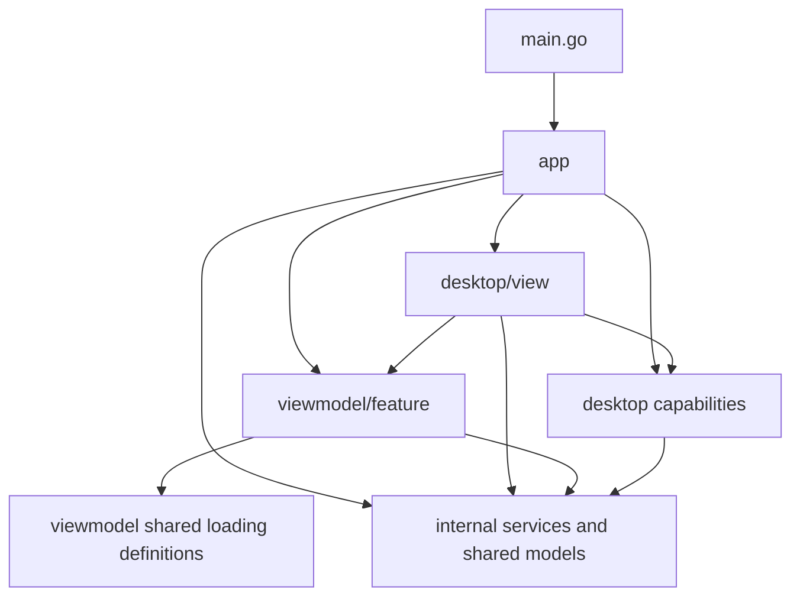

# 架构与依赖边界

本项目按**职责、状态所有权和依赖方向**组织代码。目录不追求对称，不以文件数或行数作为架构指标。小功能可以使用现有模型和单个视图文件；独立能力需要隔离依赖或复用时才建立新包。

配套阅读：[代码规范](coding-standards.md)、[数据与生命周期](data-lifecycle.md)、[新增功能](adding-features.md)、[功能索引](features/README.md)。

## 1. 总体结构

```text
main.go
└── internal/app                 应用组合、跨功能协调、原生生命周期
    ├── internal/desktop/view    控件、输入、布局、动画与窗口内容
    ├── internal/viewmodel       功能状态、命令、请求身份和重试
    ├── internal/desktop/*      封面、快捷键与订阅等桌面能力
    └── internal/*              播放、API、存储及共享模型
```

视图读取功能模型及服务公开的数据；后台 I/O 由服务承担。App 选择实例和运行时作用域，将必要函数或小接口注入功能与视图。



图表示允许的总体方向，不要求每个包都产生全部依赖。服务之间可以按实际能力依赖，但必须无环；不能把功能协调改名为底层服务来绕开边界。

## 2. 包职责

| 包或目录 | 拥有的职责 | 不应承担 |
| --- | --- | --- |
| `internal/app` | 启停、账号会话、接线、原生窗口、跨功能命令、结果分发 | 歌词算法、缓存淘汰实现、页面控件细节 |
| `desktop/view` | 简单功能视图与视图子包组合 | 复制播放器、保存凭据、决定账号生命周期 |
| `desktop/view/components` | 图标、按钮、封面呈现、格式化、骨架、配色 | 功能请求、全局业务数据 |
| `desktop/view/page` | 页面共用布局和渲染能力 | 导航历史、数据加载 |
| `desktop/view/shell` | 主窗口、侧栏、页面控件状态、覆盖层构建策略 | 自行请求数据、复制导航器 |
| `desktop/view/playback` | 播放栏、歌词、字幕、封面墙、舞台、桌面歌词和刘海界面 | 音频解码、账号缓存身份 |
| `desktop/view/settings` | 设置导航、搜索、控件和对话框 | 配置文件格式、跨窗口生命周期、搬运事务 |
| `desktop/view/tracklist` | 虚拟行、稳定行身份、可见区和歌曲定位 | 队列所有权、网盘后台加载 |
| `desktop/view/artist`、`library`、`local`、`search` | 对应功能的展示和输入 | 其他功能模型的内部状态 |
| `viewmodel/<feature>` | 数据、表单、命令、加载、错误、重试、请求身份 | MyGo 控件、窗口、字体测量、其他功能 ViewModel |
| `viewmodel` 根包 | 共享加载状态和刷新时机等小定义 | 万能基类、全局功能容器 |
| `library` | 喜欢、歌单、收藏专辑等共享集合和编辑规则 | 窗口刷新、账号会话协调 |
| `localcatalog` | 本地曲库、扫描、编辑和歌词匹配持久化 | 文件选择器、弹窗、滚动 |
| `player` | 队列、模式、音源、解码、预取、下载缓冲、歌曲缓存、频谱、播放事件 | 页面布局、导出文件命名 |
| `netease` | 协议、请求、会话、响应模型、错误分类和图片网络缓存 | 页面布局、功能间导航 |
| `lyrics` | LRC/YRC、翻译与署名、展示时间线、歌词缓存 | 字体、Shader、窗口、输入 |
| `download`、`download/tagging`、`audioformat` | 音频导出、标签写入、实际格式识别 | 下载队列界面、第二套播放器 |
| `speech`、`speech/transcript` | 本地识别、模型与库、字幕文本及覆盖范围 | 应用窗口、字幕控件 |
| `cache/disk`、`cache/move`、`cache/page` | 磁盘快照与索引、迁移事务、页面数据保留 | 原生目录选择、账号菜单 |
| `preferences`、`player/session`、`userdata` | 配置、播放会话、用户数据写入 | 系统主题、设置控件、原生对话框 |
| `navigation` | 路由与前后历史 | 页面构建与请求调度 |
| `mixvol` | Windows/Linux 应用音量接入及其他平台回退 | 播放栏控件 |
| `desktop/artwork` | 图片解码、尺寸变体、内嵌封面、候选匹配、位图缓存及背景图预算/淘汰 | 当前账号、播放来源、展示文案 |
| `desktop/shortcuts` | 动作描述、按键转换、默认值和冲突规则 | 命令执行、全局注册生命周期 |
| `desktop/lifetime` | 原生订阅一次性释放 | 应用退出决策 |
| `testutil`、各包 `testdata` | 共用测试机制与归属明确的样本 | 生产依赖 |

表中未带 `internal/` 的路径均位于 `internal/` 下。

缓存体系统一放在 `internal/cache/` 命名空间中，`disk`、`page`、`move` 仍是独立 Go 包：磁盘缓存和页面内存缓存不依赖其他缓存子包，目录迁移按需组合磁盘缓存能力。缓存根目录不增加共享业务状态或统一管理器。

持久化与辅助能力归入所属领域：`player/session` 保存播放会话，`speech/transcript` 保存转写文本和覆盖范围，`download/tagging` 写入导出文件的标签。会话、转写存储继续使用父包的值类型，父包不回引其存储子包；App 和 ViewModel 保留原有协调职责。标签写入独立于下载调度和播放器，播放器的格式测试可以直接复用该子包。这里只调整源码组织，不迁移用户数据或改变存储格式。

## 3. 强制依赖规则

1. 其他包禁止导入 `internal/app`。需要应用操作时注入函数或能力接口。
2. ViewModel 禁止导入 MyGo 和桌面层，必须能在没有窗口的测试中运行。
3. 功能 ViewModel 禁止导入另一个功能 ViewModel；可使用根 `viewmodel`、自身实现子包和底层模型。跨功能协调放在 App。
4. 底层服务禁止导入 ViewModel 或桌面层；API 和存储不认识页面。
5. 桌面能力包可以使用 MyGo，但不能依赖视图和 ViewModel。
6. 生产代码禁止导入测试辅助包；测试可以组合多层来验证真实边界。
7. 视图间组合传必要数据或回调，不把 App 暴露成万能服务。
8. `cache/disk`、`cache/page` 不导入其他缓存子包，迁移编排归 `cache/move`；`download/tagging` 不依赖下载调度包或 `player`，保持标签能力可独立使用。

[边界测试](../internal/architecture/boundaries_test.go)解析所有平台的生产 Go 文件，包括本机构建标签排除的文件。它检查导入，不能替代状态所有权和副作用审查。

```sh
go test ./internal/architecture
```

## 4. 状态所有权

| 状态 | 所有者 | 更新方式 |
| --- | --- | --- |
| 当前歌曲、位置、队列、模式 | `player.Player` | 播放命令和音频事件 |
| 喜欢、歌单、收藏专辑 | `library.State`，由 Library ViewModel 协调 | 发布替代集合，保留借出的快照 |
| 分页、查询、错误、加载 | 功能 ViewModel | 所属线程执行命令和接受结果 |
| 账号重置、启动意图、退出 | App | 生命周期协调和失效检查 |
| 焦点句柄、滚动、动画、几何缓存 | 视图 State | 构建和输入事件 |
| 用户输入 | 功能表单或配置 | 明确输入操作；不只存临时局部变量 |
| 磁盘队列与资源句柄 | 存储、下载等服务 | 自有同步和取消机制 |

视图不能另存一份可变业务事实，如另一份当前歌曲或账号收藏。动画保留旧图片、几何或只读快照是允许的，但必须有明确用途和释放条件。

## 5. App 文件的边界

判断函数是否留在 App，看它是否协调多个所有者或原生生命周期，而不是文件名是否像功能。

| `internal/app` 文件组 | 保留责任 |
| --- | --- |
| `app.go`、`runtime.go`、`shutdown.go` | 组合根、启动排序、部分初始化失败、退出顺序 |
| `dispatch.go` | UI 投递、退出拒绝、资源结果丢弃释放 |
| `windows.go`、`settings_window.go`、`view_state.go` | 原生窗口和各窗口持久控件状态 |
| `view.go`、`view_bindings.go`、`bindings_*.go` | 路由组合和一次性接线 |
| `account.go`、`network.go`、`recovery.go` | 会话切换、系统网络通知、可见功能联合恢复 |
| `cache.go`、`cache_directory.go`、`playlist_cache.go` | scope/epoch、缓存实例、迁移暂停恢复、写入预约 |
| `settings.go`、`appearance.go` | 配置到系统外观和共享图片资源的适配 |
| `menu.go`、`tray.go`、`hotkeys.go`、`updates.go`、`fileassoc*.go` | 菜单、托盘、原生注册、更新和文件关联 |
| `play_commands.go`、`play_report.go`、`session.go`、`pickup.go` | 页面来源、登录与上报、保存恢复时机 |
| `playback_artwork.go`、`track_artwork.go` | 当前封面来源、预热及过期发布；匹配算法在 artwork |
| `home.go`、`search.go`、`details.go`、`cloud.go` 等 | 注入账号、API、缓存、导航和播放命令 |
| `local_music.go`、`local_open.go`、`local_lyrics.go`、`local_window.go` | 曲库接线、系统打开事件和目录窗口 |
| `download.go`、`captions.go` | 下载/转写与账号、设置、播放器、退出之间的协调 |
| `debug_shots.go`、`cputime_*.go` | 依赖整个应用的截图与性能观测 |

纯转换、排序、去重或无需应用生命周期的规则应放到所属模块。不能为了缩小 App，把整个 App 实例传给新包。

## 6. 一次性接线

[newApp](../internal/app/runtime.go)在渲染前调用 [bindDesktopViews](../internal/app/view_bindings.go)，分 shared、browse、library、playback 和 settings 五组。

- 视图实例和 State 地址稳定，跨视图方法值使用指针接收者。
- 所有组接线完成后才执行视图；不在每帧重建整套服务。
- 回调执行时读取当前账号、页面来源、配置和播放器，不在初次接线时冻结会变化的值。
- 接口贴近消费者需要。已有具体数据类型足够时直接使用，不为单一实现建立多层包装。
- 仅改名转发的函数应有实际边界价值，否则直接调用所属模块。

## 7. 完整调用链

异步页面：用户打开 → App 更新导航并调用模型命令 → ViewModel 建立请求身份 → 服务后台 I/O → 注入的发布器回到所属线程 → 检查账号和请求有效 → 发布状态 → 重绘。旧磁盘结果不能覆盖新网络结果，失败不随意清空可用数据。

侧栏开关：[设置视图](../internal/desktop/view/settings/sidebar.go)修改 `HiddenSidebarPages` → 现有 Changed 保存并刷新 → [App](../internal/app/view.go)传值给 [shell.Sidebar](../internal/desktop/view/shell/sidebar.go) → 只过滤入口。没有新 ViewModel、请求或导航器，也不关闭页面。这说明纯显示偏好不需要机械建立完整四层包。

## 8. 结构变更验收

移动前记录入口、调用者、状态与释放路径。按函数职责迁移测试，不按文件名整批搬迁。检查旧入口无遗留、测试变化有理由、平台标签与嵌入资源有效、共享状态未复制、数据格式未意外改变、文档指向新所有者。

架构文档维护当前结构，不记录“从多少文件减少到多少文件”等一次性过程；迁移历史由 Git 保存。
